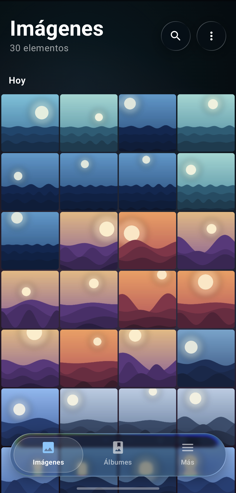
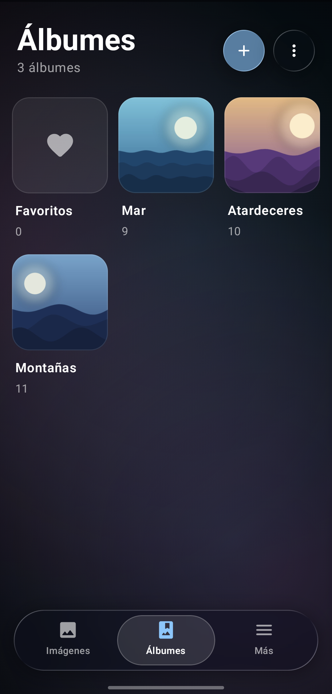
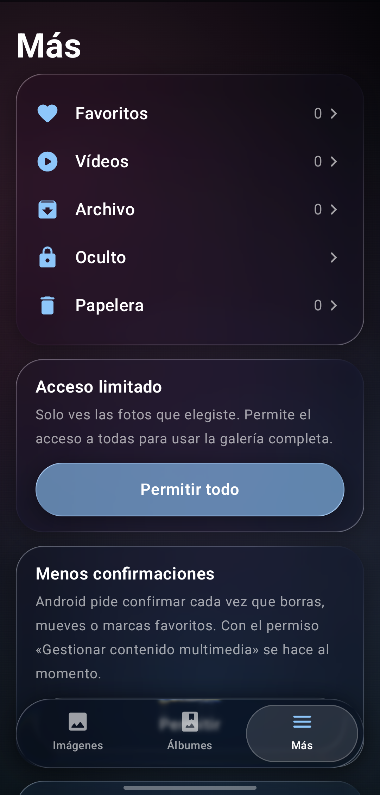
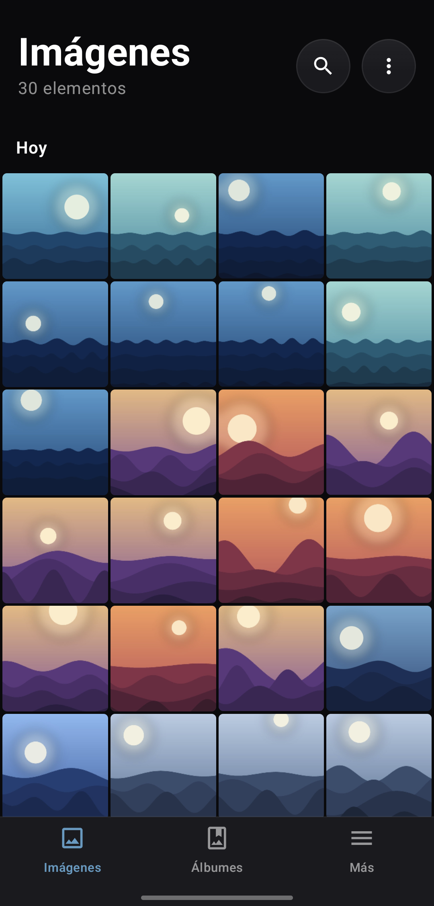
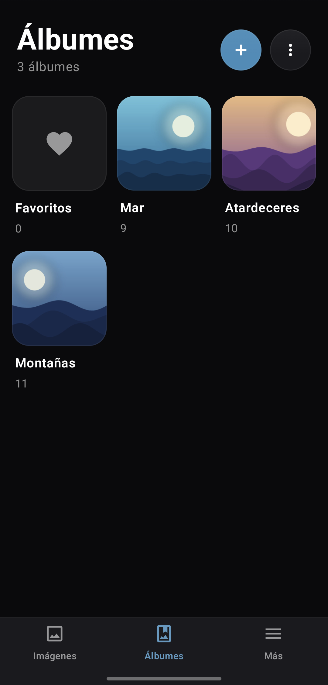
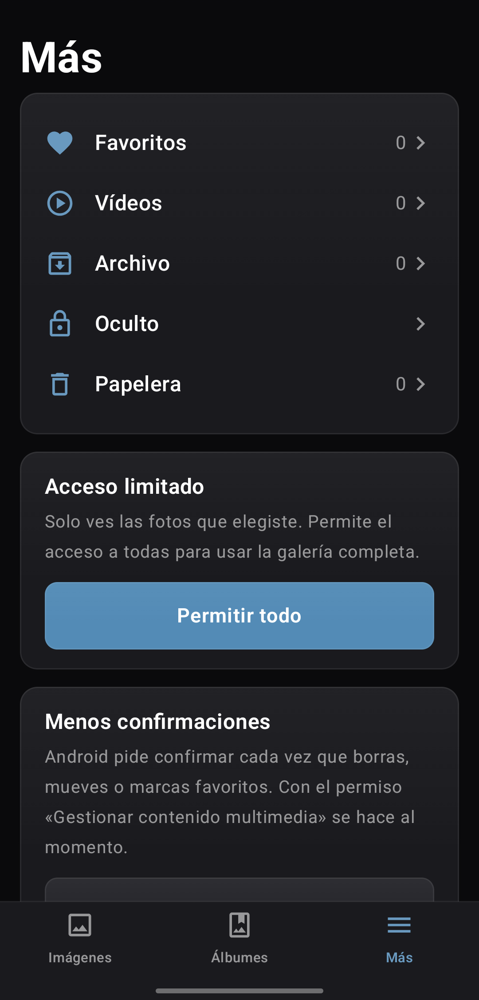

# Liquid Gallery

**English** | [Español](README.es.md)

Installs on the phone as **Gallery** (*Galería* in Spanish).

A free, tracker-free Android gallery inspired by Samsung's, with the same liquid-glass interface
as [Liquid Clock](https://github.com/mrsalvaa/liquid-clock): surfaces that refract what's behind them (thanks to
[Backdrop](https://github.com/Kyant0/AndroidLiquidGlass)) and buttons that squish like a droplet.
If you'd rather have something plainer, Settings has a Solid style: opaque cards, small corners and
outline icons.

**It doesn't request the internet permission**, and has no ads or telemetry. Licensed under GPL-3.0.

<p align="center"><b>Liquid Glass</b></p>
<p align="center">
  
  
  
</p>
<p align="center"><b>Solid</b></p>
<p align="center">
  
  
  
</p>

Screenshots use made-up sample images.

## Features

- **Pictures**: grid grouped by day (or by month at 6–8 columns), pinch to change columns,
  long-press and drag to multi-select, tap a date to select the whole day, fast date scroller.
- **Viewer**: swipe between items, pinch/double-tap zoom with tiled loading for huge photos, video
  playback with glass controls, animated GIFs. Swipe down to close, up for details (EXIF).
- **Albums**: Camera first, Favorites and Videos, create albums, move/copy, hide albums, album
  groups, custom/name/count/date ordering.
- **Archive** (hidden from Pictures, kept in its album) and **Hidden**: a private vault inside the
  app, unlocked with fingerprint, face or the phone's PIN. Uninstalling the app deletes it.
- **Trash and favorites**: Android's own, shared with other galleries; trash empties after 30 days.
- **Offline search** by name, album, date or type.
- **Editor**: crop with aspect ratios, rotate, flip, brightness, contrast, saturation, warmth and
  filters; hold to compare; save as a copy or overwrite.
- Works as a photo/video viewer for other apps.

## Download

See the [changelog](CHANGELOG.md) for what's new in each version.

Get the APK from [Releases](../../releases) and install it (Android 12 or later).

Check the file wasn't altered:

```bash
sha256sum -c liquid-gallery-v0.7.1.apk.sha256
```

And that it's signed with the project key (certificate SHA-256 fingerprint):

```
48:2B:BE:8C:2B:AF:CA:85:A0:A7:57:78:EA:EB:A4:64:3E:23:85:AD:FB:DE:23:2E:F8:30:F4:B5:8B:4C:A5:61
```

```bash
apksigner verify --print-certs liquid-gallery-v0.7.1.apk
```

## Build

```bash
JAVA_HOME=/usr/lib/jvm/java-17-openjdk ./gradlew assembleRelease
```
